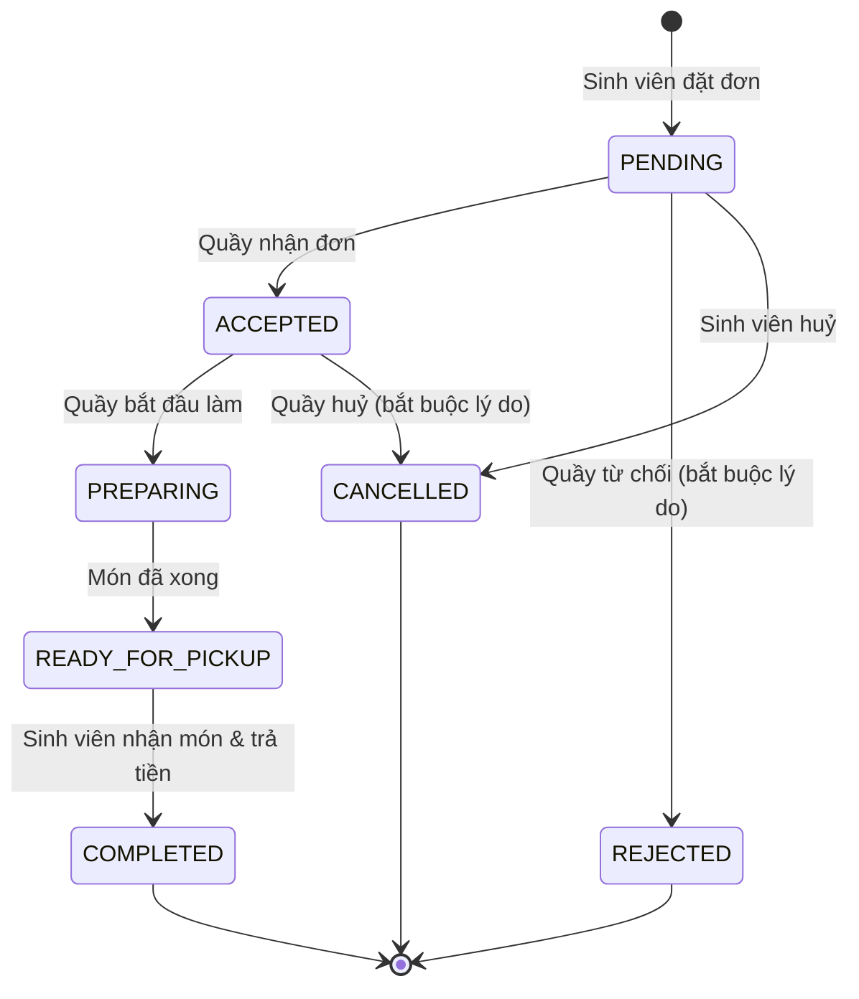

# Quy tắc nghiệp vụ: đơn hàng & thanh toán

## 1. Một đơn — một quầy

QuickBite áp dụng quy tắc **mỗi đơn hàng chỉ gồm món của MỘT quầy** (single-stall-per-order).

- Giỏ hàng chỉ chứa món của một quầy. Khi sinh viên thêm món của quầy khác, API trả lỗi `409 CART_STALL_CONFLICT`. Giao diện hỏi sinh viên có muốn **xoá giỏ hiện tại** để bắt đầu giỏ mới không.
- Lý do: mỗi quầy tự nhận, chuẩn bị và giao đơn riêng, nên một đơn một quầy giúp trạng thái đơn rõ ràng và tránh phải tách đơn con.

## 2. Máy trạng thái đơn hàng

| Chuyển trạng thái | Ai được thực hiện |
|---|---|
| `PENDING → ACCEPTED` | Nhân viên của quầy, Admin |
| `PENDING → REJECTED` | Nhân viên của quầy, Admin (bắt buộc lý do) |
| `PENDING → CANCELLED` | Sinh viên chủ đơn, Admin |
| `ACCEPTED → PREPARING` | Nhân viên của quầy, Admin |
| `ACCEPTED → CANCELLED` | Nhân viên của quầy, Admin (bắt buộc lý do) |
| `PREPARING → READY_FOR_PICKUP` | Nhân viên của quầy, Admin |
| `READY_FOR_PICKUP → COMPLETED` | Nhân viên của quầy, Admin |

- Mọi chuyển trạng thái khác bị **server từ chối** (`422`), dù client gửi gì.
- **Sinh viên chỉ được huỷ khi đơn còn `PENDING`** (quầy chưa nhận). Sau khi quầy đã nhận, sinh viên cần liên hệ quầy.
- Mỗi lần chuyển trạng thái được ghi vào `order_status_history` và tạo thông báo cho sinh viên.
- Dùng cập nhật có điều kiện (`WHERE id = ? AND status = <trạng thái cũ>`) để hai nhân viên bấm cùng lúc không làm hỏng trạng thái.

- Khi đơn chuyển sang `COMPLETED`, số phần đã bán (`menu_items.soldCount`) được cộng ngay trong cùng transaction (dùng cho sắp xếp "bán chạy").
- Hai nhân viên bấm cùng lúc: chỉ một người thành công, người còn lại nhận `409` và giao diện tự tải lại (có test kiểm chứng).

## 3. Thanh toán

Có hai phương thức thanh toán:
- **Tiền mặt khi nhận món** (`CASH_ON_PICKUP`).
- **Chuyển khoản VietQR** (`VIETQR`): tiền vào thẳng tài khoản của quầy. Chi tiết xem [payments.md](payments.md).

Trạng thái thanh toán (`paymentStatus`) tách riêng khỏi trạng thái đơn:

| Sự kiện | `paymentStatus` |
|---|---|
| Tạo đơn | `UNPAID` |
| Tiền mặt: quầy chuyển đơn sang `COMPLETED` (đã giao món và thu tiền) | `PAID` (`provider = CASH`, ghi `paidAt`, `confirmedById`) |
| VietQR: webhook SePay khớp giao dịch, hoặc quầy bấm "Đã nhận tiền" | `PAID` (`provider = SEPAY` / `MANUAL`) |
| Đơn bị `CANCELLED` / `REJECTED` khi chưa thu tiền (kể cả tự huỷ vì quá hạn chuyển khoản) | `VOIDED` |
| (Tương lai) quầy ghi nhận đã hoàn tiền | `REFUNDED` |

- Server **không bao giờ** đánh dấu `PAID` dựa vào dữ liệu client gửi lên.
- Đơn VietQR chưa có tiền thì quầy **không nhận đơn được**, chỉ từ chối được. Sinh viên **không tự huỷ** đơn đã trả tiền.
- **Hoàn tiền:**
  - Tiền mặt chỉ thu khi giao món, nên huỷ đơn không phát sinh hoàn tiền.
  - Với VietQR, đơn đã trả mà bị huỷ/từ chối, hoặc tiền về sau khi đơn đã tự huỷ, thì quầy nhận thông báo **"Cần hoàn tiền"** và tự hoàn tiền cho sinh viên.

## 4. Tạo đơn hàng an toàn

Khi nhận `POST /api/v1/orders`, server (trong **một transaction**):

1. Lấy giỏ hàng của sinh viên từ DB (không tin danh sách món/giá do client gửi).
2. Kiểm tra: giỏ không rỗng, quầy đang hoạt động & nhận đơn, mọi món còn bán (`isActive`) và còn hàng (`isAvailable`), điểm nhận hợp lệ, giờ nhận (nếu có) nằm trong giờ mở cửa và không ở quá khứ.
3. Tính lại giá từng dòng, tạm tính, phí, giảm giá và tổng tiền **từ giá trong DB**.
4. Tạo `orders`, `order_items` (snapshot tên/giá), `payments`, `order_status_history`, `notifications`.
5. Xoá giỏ hàng.

Chống đặt trùng: client gửi `idempotencyKey` (UUID) cho mỗi lần checkout. Nếu khoá đã tồn tại, server trả lại đơn đã tạo thay vì tạo đơn mới.
Kể cả khi hai request cùng khoá tới **đồng thời**, ràng buộc `UNIQUE(studentId, idempotencyKey)` trong MySQL đảm bảo chỉ một đơn được tạo; request còn lại nhận về đơn đó (có test kiểm chứng).

## 5. Giờ nhận món

- Khung giờ mỗi 15 phút, sớm nhất **sau 15 phút** kể từ lúc đặt, muộn nhất **4 giờ** sau, và phải nằm trong giờ mở cửa của quầy (giờ Việt Nam).
- Không chọn giờ = "sớm nhất có thể".
- Server kiểm tra lại giờ nhận khi tạo đơn (cho phép lệch 5 phút do thời gian người dùng ở trang thanh toán).

## 6. Giỏ hàng

- Lưu trong DB theo tài khoản, nên đăng nhập trên thiết bị khác vẫn thấy giỏ.
- Mỗi món tối đa 20 phần, giỏ tối đa 30 món khác nhau. Thêm lại cùng món sẽ cộng dồn số lượng.
- Món trong giỏ bị hết hàng / ngừng bán sau đó vẫn hiển thị kèm cảnh báo, và không cho thanh toán tới khi xoá món đó.

## 7. Quyền trong quầy

| Thao tác | Chủ quầy (OWNER) | Nhân viên (STAFF) | Admin |
|---|:-:|:-:|:-:|
| Xem tổng quan, báo cáo doanh thu | ✅ | ✅ | ✅ |
| Nhận / từ chối / xử lý đơn | ✅ | ✅ | ✅ |
| Bật / tắt nhận đơn | ✅ | ✅ | ✅ |
| Thêm / sửa món, đổi giá, bật tắt còn món, ngừng bán | ✅ | ✅ | ✅ |
| Sửa thông tin quầy (mô tả, giờ mở cửa, ảnh bìa) | ✅ | ❌ | ✅ |
| Đổi tên / vị trí quầy, bật tắt quầy, gán nhân sự | ❌ | ❌ | ✅ |

Nhân viên được sửa thực đơn vì đây là việc vận hành hằng ngày (hết món, đổi giá theo nguyên liệu).

## 8. Đánh giá & kiểm duyệt

- Chỉ sinh viên chủ đơn được đánh giá, chỉ đơn **đã hoàn thành**, **mỗi đơn một lần** (1–5 sao, nhận xét tuỳ chọn).
- Người dùng đã đăng nhập có thể **báo cáo** đánh giá không phù hợp. Báo cáo **không** ẩn đánh giá: đánh giá vẫn hiển thị và vẫn tính điểm cho tới khi admin quyết định.
- Không báo cáo được đánh giá của chính mình; chủ quầy / nhân viên không báo cáo được đánh giá về quầy mình.
- Admin **ẩn** (không hiển thị, không tính điểm trung bình) hoặc **giữ lại** đánh giá; mọi quyết định được ghi nhật ký.
