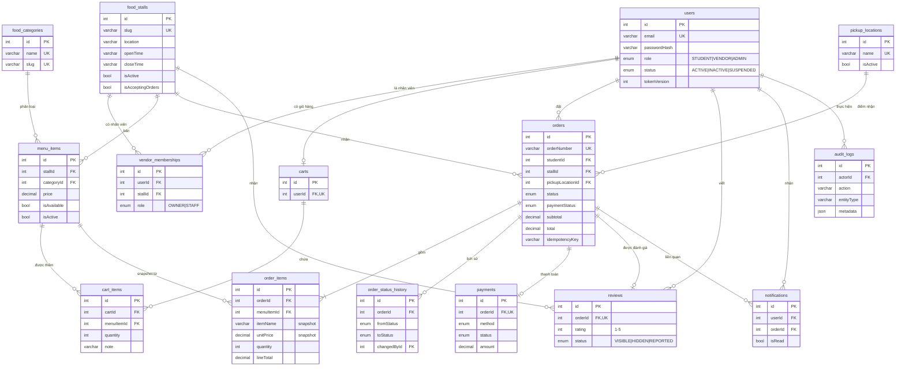

# Thiết kế cơ sở dữ liệu QuickBite

- Hệ quản trị: **MySQL 8.x**, bảng mã `utf8mb4` (hỗ trợ tiếng Việt và emoji).
- Lược đồ định nghĩa trong [`backend/prisma/schema.prisma`](../backend/prisma/schema.prisma), quản lý bằng Prisma Migrate.
- Tiền tệ lưu bằng `DECIMAL(12,2)` (đơn vị VND), **không** dùng số thực dấu phẩy động.
- Thời gian lưu dạng `DATETIME(3)` theo **UTC**; giao diện tự đổi sang giờ Việt Nam.

## Sơ đồ quan hệ (ER)

## Giải thích các quyết định thiết kế

| Bảng | Lý do / ghi chú |
|---|---|
| `users.role` | Mỗi người dùng có **một** vai trò (enum). Đủ cho 3 vai trò của đề bài, đơn giản hơn bảng Role riêng. |
| `users.tokenVersion` | Tăng lên khi đổi mật khẩu hoặc khoá tài khoản → mọi JWT cũ bị vô hiệu ngay. |
| `vendor_memberships` | Một quầy có nhiều nhân viên (OWNER/STAFF); admin gán người dùng vào quầy. Mọi API vendor kiểm tra bảng này để đảm bảo **chỉ thao tác trên quầy của mình**. |
| `menu_items.isActive` | Xoá mềm. Món đã từng được đặt **không bao giờ bị xoá cứng** (khoá ngoại `order_items → menu_items` là `RESTRICT`). |
| `menu_items.isAvailable` | Còn/hết món theo ngày, khác với ngừng kinh doanh. |
| `carts`, `cart_items` | Giỏ hàng lưu trong DB nên giữ nguyên giữa các thiết bị. `UNIQUE(cartId, menuItemId)`: thêm lại cùng món sẽ cộng dồn số lượng. |
| `order_items.itemName/unitPrice` | **Snapshot** tên & giá lúc đặt. Đổi giá món sau này không làm sai lịch sử đơn. |
| `orders.idempotencyKey` | `UNIQUE(studentId, idempotencyKey)`: bấm "Đặt hàng" hai lần (hoặc mạng gửi lại) chỉ tạo **một** đơn. |
| `orders.paymentStatus` + `payments` | Trạng thái thanh toán tách khỏi trạng thái đơn. Bảng `payments` sẵn sàng lưu mã giao dịch khi tích hợp cổng thanh toán. |
| `order_status_history` | Ghi lại từng lần chuyển trạng thái (ai, khi nào) để sinh viên theo dõi đơn và phục vụ kiểm tra. |
| `reviews.orderId UNIQUE` | Mỗi đơn hoàn thành chỉ được đánh giá một lần. |
| `audit_logs` | Ghi lại thao tác quản trị quan trọng (khoá tài khoản, tạo quầy, gán nhân viên...). |

## Hành vi khi xoá (ON DELETE)

| Quan hệ | Hành vi | Lý do |
|---|---|---|
| `orders → users / food_stalls / pickup_locations` | `RESTRICT` | Không được xoá dữ liệu đang có đơn lịch sử; dùng khoá tài khoản / tắt quầy / tắt điểm nhận. |
| `order_items → menu_items` | `RESTRICT` | Giữ lịch sử; món ngừng bán được xoá mềm (`isActive = false`). |
| `order_items, order_status_history, payments → orders` | `CASCADE` | Thuộc về đơn hàng. |
| `cart_items → carts, menu_items` | `CASCADE` | Dữ liệu tạm. |
| `vendor_memberships → users, food_stalls` | `CASCADE` | Quan hệ liên kết. |
| `audit_logs.actorId`, `order_status_history.changedById` | `SET NULL` | Giữ nhật ký kể cả khi người thực hiện không còn. |
