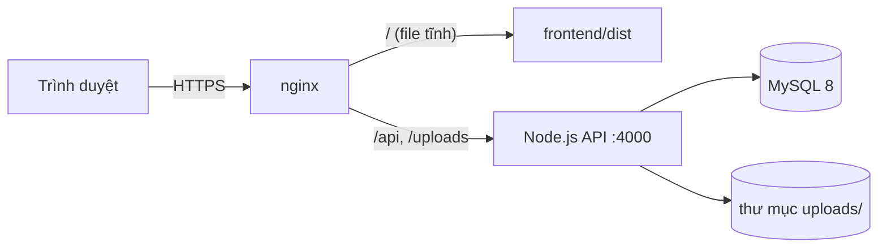

# Triển khai production

Hướng dẫn tham khảo để chạy QuickBite trên một máy chủ (Linux hoặc Windows Server) với **một domain**,
trong đó nginx phục vụ giao diện tĩnh và chuyển `/api`, `/uploads` sang backend Node.js.



Dùng chung một domain giúp cookie đăng nhập là cookie "cùng site", không cần cấu hình CORS phức tạp.

## 1. Chuẩn bị

- Node.js 20+ (khuyên dùng bản LTS), MySQL 8.x, nginx, chứng chỉ HTTPS (vd Let's Encrypt).
- Tạo user MySQL riêng cho ứng dụng, **chỉ có quyền trên database `quickbite`** (không dùng root):

```sql
CREATE DATABASE quickbite CHARACTER SET utf8mb4 COLLATE utf8mb4_unicode_ci;
CREATE USER 'quickbite'@'localhost' IDENTIFIED BY '<mật khẩu mạnh>';
GRANT SELECT, INSERT, UPDATE, DELETE, CREATE, ALTER, INDEX, REFERENCES, DROP ON quickbite.* TO 'quickbite'@'localhost';
```

> `prisma migrate deploy` (dùng ở production) **không cần** shadow database, nên không cần quyền trên toàn server như khi phát triển.

## 2. Backend

```bash
cd backend
npm ci
npm run build
```

Tạo `backend/.env` (không commit file này):

| Biến | Giá trị production |
|---|---|
| `NODE_ENV` | `production` |
| `PORT` | `4000` |
| `DATABASE_URL` | `mysql://quickbite:<mật khẩu>@localhost:3306/quickbite` |
| `JWT_SECRET` | Chuỗi ngẫu nhiên **mới** ≥ 64 ký tự: `node -e "console.log(require('crypto').randomBytes(48).toString('hex'))"` |
| `JWT_EXPIRES_IN` | vd `1d` hoặc `7d` |
| `CORS_ORIGINS` | `https://quickbite.truong.edu.vn` |
| `TRUST_PROXY` | `1` (có đúng một nginx đứng trước) |
| `IMAGE_HOSTS` | Tên miền ảnh được phép, hoặc để trống nếu chỉ dùng ảnh tự tải lên |
| `UPLOAD_DIR` | Đường dẫn tuyệt đối, vd `/var/lib/quickbite/uploads` (nên sao lưu) |
| `LOG_LEVEL` | `info` |
| `API_DOCS` | Bỏ trống (tắt) hoặc `true` nếu cần trang tài liệu |

Áp dụng migration (**không** chạy seed ở production — seed bị chặn khi `NODE_ENV=production`):

```bash
npm run db:deploy
```

Tạo tài khoản admin đầu tiên: tạm thời chạy một script nhỏ hoặc dùng `npm run db:studio` từ máy quản trị để tạo người dùng `role = ADMIN` (mật khẩu phải băm bằng bcrypt), sau đó tạo các tài khoản khác từ trang **Quản trị → Người dùng**.

Chạy như dịch vụ (vd với PM2):

```bash
npm install -g pm2
pm2 start dist/server.js --name quickbite-api
pm2 save
```

Server sẽ **từ chối khởi động** nếu `.env` sai hoặc `JWT_SECRET` là giá trị mẫu.

## 3. Frontend

```bash
cd frontend
npm ci
npm run build      # kết quả ở frontend/dist
```

Mặc định giao diện gọi API ở `/api/v1` cùng domain — không cần biến môi trường.

## 4. nginx (ví dụ)

```nginx
server {
  listen 443 ssl http2;
  server_name quickbite.truong.edu.vn;
  # ssl_certificate ...; ssl_certificate_key ...;

  client_max_body_size 3m;          # lớn hơn MAX_UPLOAD_MB một chút

  root /srv/quickbite/frontend/dist;
  index index.html;

  location /api/ {
    proxy_pass http://127.0.0.1:4000;
    proxy_set_header Host $host;
    proxy_set_header X-Forwarded-For $proxy_add_x_forwarded_for;
    proxy_set_header X-Forwarded-Proto $scheme;
  }

  location /uploads/ {
    proxy_pass http://127.0.0.1:4000;
  }

  # Ứng dụng một trang (SPA): mọi đường dẫn khác trả về index.html
  location / {
    try_files $uri /index.html;
  }

  location /assets/ {
    expires 1y;
    add_header Cache-Control "public, immutable";
  }
}

server {
  listen 80;
  server_name quickbite.truong.edu.vn;
  return 301 https://$host$request_uri;
}
```

## 5. Kiểm tra sau triển khai

- [ ] `https://<domain>/api/v1/health` trả `{"status":"ok","database":"connected"}`
- [ ] Đăng nhập được, cookie `qb_session` có cờ `Secure; HttpOnly; SameSite=Lax`
- [ ] `https://<domain>/api/docs` trả 404 (nếu không bật `API_DOCS`)
- [ ] Không có tài khoản demo `@quickbite.test` trong database production
- [ ] Sao lưu định kỳ database và thư mục `UPLOAD_DIR`

## 6. Mở rộng

- Chạy nhiều tiến trình API → chuyển bộ đếm giới hạn tần suất sang Redis.
- Ảnh nhiều → lưu trên dịch vụ lưu trữ đối tượng (S3, Cloudflare R2...) thay vì ổ đĩa.
- Thông báo thời gian thực → thay polling (15–30 giây) bằng WebSocket / Server-Sent Events.
