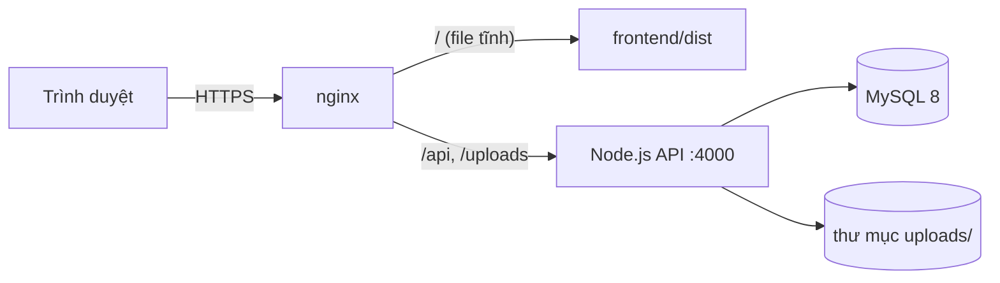

# Triển khai production

Hướng dẫn tham khảo để chạy QuickBite trên một máy chủ (Linux hoặc Windows Server) với **một domain**,
trong đó nginx phục vụ giao diện tĩnh và chuyển `/api`, `/uploads` sang backend Node.js.



Dùng chung một domain giúp cookie đăng nhập là cookie "cùng site", không cần cấu hình CORS phức tạp.

## 1. Chuẩn bị

- Node.js 20+ (khuyên dùng bản LTS), MySQL 8.x, nginx, chứng chỉ HTTPS (vd Let's Encrypt).
- Tạo user MySQL riêng cho ứng dụng, **chỉ có quyền trên database `quickbite`** (không dùng root):

```sql
CREATE DATABASE quickbite CHARACTER SET utf8mb4 COLLATE utf8mb4_unicode_ci;
CREATE USER 'quickbite'@'localhost' IDENTIFIED BY '<mật khẩu mạnh>';
GRANT SELECT, INSERT, UPDATE, DELETE, CREATE, ALTER, INDEX, REFERENCES, DROP ON quickbite.* TO 'quickbite'@'localhost';
```

> `prisma migrate deploy` (dùng ở production) **không cần** shadow database, nên không cần quyền trên toàn server như khi phát triển.

## 2. Backend

```bash
cd backend
npm ci
npm run build
```

Tạo `backend/.env` từ mẫu [`backend/.env.production.example`](../backend/.env.production.example) (không commit file này):

| Biến | Giá trị production |
|---|---|
| `NODE_ENV` | `production` |
| `PORT` | `4000` |
| `DATABASE_URL` | `mysql://quickbite:<mật khẩu>@localhost:3306/quickbite` |
| `JWT_SECRET` | Chuỗi ngẫu nhiên **mới** ≥ 64 ký tự: `node -e "console.log(require('crypto').randomBytes(48).toString('hex'))"` |
| `JWT_EXPIRES_IN` | vd `1d` hoặc `7d` |
| `CORS_ORIGINS` | `https://quickbite.truong.edu.vn` |
| `TRUST_PROXY` | `1` (có đúng một nginx đứng trước) |
| `IMAGE_HOSTS` | Tên miền ảnh được phép, hoặc để trống nếu chỉ dùng ảnh tự tải lên |
| `UPLOAD_DIR` | Đường dẫn tuyệt đối, vd `/var/lib/quickbite/uploads` (nên sao lưu) |
| `LOG_LEVEL` | `info` |
| `API_DOCS` | Bỏ trống (tắt) hoặc `true` nếu cần trang tài liệu |
| `BACKUP_DIR` | Thư mục lưu bản sao lưu, **khác ổ / khác máy** với database, vd `/var/backups/quickbite` |
| `BACKUP_KEEP` | Số bản sao lưu định kỳ giữ lại, vd `14` |

Kiểm tra cấu hình trước khi chạy (thoát mã 1 nếu còn lỗi):

```bash
npm run prod:check
```

Lệnh kiểm tra biến môi trường (NODE_ENV, JWT_SECRET, DATABASE_URL có SSL / không dùng root, CORS https, TRUST_PROXY, API_DOCS, UPLOAD_DIR, BACKUP_DIR) và database (kết nối, migration chưa áp dụng, tài khoản demo còn sót, có quản trị viên, bản sao lưu gần nhất). Không in mật khẩu ra màn hình.

Áp dụng migration (**không** chạy seed ở production — seed bị chặn khi `NODE_ENV=production`):

```bash
npm run db:deploy
```

Tạo tài khoản admin đầu tiên: tạm thời chạy một script nhỏ hoặc dùng `npm run db:studio` từ máy quản trị để tạo người dùng `role = ADMIN` (mật khẩu phải băm bằng bcrypt), sau đó tạo các tài khoản khác từ trang **Quản trị → Người dùng**.

Chạy như dịch vụ (vd với PM2):

```bash
npm install -g pm2
pm2 start dist/server.js --name quickbite-api
pm2 save
```

Server sẽ **từ chối khởi động** nếu `.env` sai hoặc `JWT_SECRET` là giá trị mẫu.

## 3. Frontend

```bash
cd frontend
npm ci
npm run build      # kết quả ở frontend/dist
```

Mặc định giao diện gọi API ở `/api/v1` cùng domain — không cần biến môi trường.

## 4. nginx (ví dụ)

```nginx
server {
  listen 443 ssl http2;
  server_name quickbite.truong.edu.vn;
  # ssl_certificate ...; ssl_certificate_key ...;

  client_max_body_size 3m;          # lớn hơn MAX_UPLOAD_MB một chút

  root /srv/quickbite/frontend/dist;
  index index.html;

  location /api/ {
    proxy_pass http://127.0.0.1:4000;
    proxy_set_header Host $host;
    proxy_set_header X-Forwarded-For $proxy_add_x_forwarded_for;
    proxy_set_header X-Forwarded-Proto $scheme;
  }

  location /uploads/ {
    proxy_pass http://127.0.0.1:4000;
  }

  # Ứng dụng một trang (SPA): mọi đường dẫn khác trả về index.html
  location / {
    try_files $uri /index.html;
  }

  location /assets/ {
    expires 1y;
    add_header Cache-Control "public, immutable";
  }
}

server {
  listen 80;
  server_name quickbite.truong.edu.vn;
  return 301 https://$host$request_uri;
}
```

## 5. Kiểm tra sau triển khai

- [ ] `npm run prod:check` không còn mục ❌
- [ ] `https://<domain>/api/v1/health` trả `{"status":"ok","database":"connected"}`
- [ ] Đăng nhập được, cookie `qb_session` có cờ `Secure; HttpOnly; SameSite=Lax`
- [ ] `https://<domain>/api/docs` trả 404 (nếu không bật `API_DOCS`)
- [ ] Không có tài khoản demo `@quickbite.test` trong database production
- [ ] Đã đặt lịch sao lưu tự động (mục 7.2) và **diễn tập khôi phục** thành công ít nhất một lần (mục 7.4)

## 6. Mở rộng

- Chạy nhiều tiến trình API → chuyển bộ đếm giới hạn tần suất sang Redis.
- Ảnh nhiều → lưu trên dịch vụ lưu trữ đối tượng (S3, Cloudflare R2...) thay vì ổ đĩa.
- Thông báo thời gian thực → thay polling (15–30 giây) bằng WebSocket / Server-Sent Events.

## 7. Sao lưu & khôi phục

### 7.1 Sao lưu

```bash
cd backend
npm run db:backup                              # bản định kỳ
npm run db:backup -- --label=truoc-trien-khai  # bản có nhãn, không bị xoá tự động
```

| Đặc điểm | Chi tiết |
|---|---|
| Kết quả | `<BACKUP_DIR>/quickbite_backup_<YYYY-MM-DD_HHmmss>.sql.gz` (nén gzip) + file kiểm tra `.json` cùng tên |
| File kiểm tra `.json` | Mã SHA-256 của file, số dòng từng bảng, migration Prisma mới nhất, thời gian, dung lượng |
| Nhất quán | `mysqldump --single-transaction`: ảnh chụp tại một thời điểm, **không khoá bảng**, chạy được khi đang có người đặt món |
| Database trên cloud | Tự bật `--ssl-mode=REQUIRED` khi `DATABASE_URL` có tham số SSL hoặc host không phải máy local (ép bằng `DB_SSL`) |
| Giữ bao nhiêu bản | `BACKUP_KEEP` (mặc định 14) bản định kỳ mới nhất; bản có nhãn (`truoc-trien-khai`, `truoc-khoi-phuc`) giữ lại |
| Bảo mật | Mật khẩu truyền qua biến `MYSQL_PWD`, không hiện trên dòng lệnh. File chứa dữ liệu cá nhân: đã chặn trong `.gitignore` |

Ngoài database, sao lưu cả thư mục **`UPLOAD_DIR`** (ảnh tải lên), vd đồng bộ sang cùng nơi với `BACKUP_DIR`.

### 7.2 Lịch sao lưu tự động

**Linux (cron)**: 2 giờ sáng mỗi ngày:

```cron
0 2 * * * cd /srv/quickbite/backend && npm run db:backup >> /var/log/quickbite-backup.log 2>&1
```

**Windows (Task Scheduler)**: chạy PowerShell với quyền của tài khoản dịch vụ:

```powershell
schtasks /Create /TN "QuickBite sao luu DB" /SC DAILY /ST 02:00 /TR "cmd /c cd /d D:\quickbite\backend && npm run db:backup >> D:\quickbite-backups\backup.log 2>&1"
```

Khuyến nghị: `BACKUP_DIR` là thư mục được đồng bộ ra ngoài máy chủ (OneDrive / Google Drive / ổ mạng), để mất máy chủ vẫn còn bản sao lưu.

**Database Aiven** (bản demo trên Vercel): chạy `npm run db:backup` từ máy quản trị với `DATABASE_URL` của Aiven (URL có tham số SSL). Xem thêm phần sao lưu tự động trong bảng điều khiển Aiven của gói đang dùng.

### 7.3 Khôi phục khi có sự cố

1. **Dừng ghi dữ liệu:** tắt API (`pm2 stop quickbite-api`) hoặc tạm khoá ứng dụng, để không có đơn mới trong lúc khôi phục.
2. **Chọn bản sao lưu:** bản mới nhất trước thời điểm sự cố trong `BACKUP_DIR`.
3. **Khôi phục:**

   ```bash
   npm run db:restore -- "/var/backups/quickbite/quickbite_backup_2026-11-20_020000.sql.gz" --yes --confirm=quickbite
   ```

   Script tự làm theo thứ tự:
   - kiểm tra SHA-256 (file hỏng / bị sửa → dừng, chưa đụng database);
   - **sao lưu database hiện tại** (nhãn `truoc-khoi-phuc`, để quay lại nếu chọn nhầm bản);
   - xoá và tạo lại database, nạp file;
   - so số dòng từng bảng và migration với lúc sao lưu.
4. **Đồng bộ schema:** nếu code đang chạy mới hơn bản sao lưu, chạy `npm run db:deploy`.
5. **Kiểm tra:** chạy `npm run prod:check` và `npm run db:check`, rồi mở lại API (`pm2 start quickbite-api`) và thử đăng nhập / đặt một đơn.

Các lớp bảo vệ: phải có `--yes`; ghi đè database chính ở production / cloud phải gõ thêm `--confirm=<tên database>`; sai tên database bị từ chối.

### 7.4 Diễn tập khôi phục (nên làm mỗi tháng)

Khôi phục vào **database khác**, không ảnh hưởng hệ thống đang chạy:

```bash
npm run db:backup
npm run db:restore -- "<file vừa tạo>" --yes --database=quickbite_restore_test
```

Kết quả mong đợi: dòng `✅ Khớp hoàn toàn với lúc sao lưu`. Xong thì xoá database thử: `DROP DATABASE quickbite_restore_test;`.

## 8. Vercel + Aiven (bản demo)

| Thành phần | Cấu hình |
|---|---|
| Biến môi trường | Vercel → Project → Settings → Environment Variables (môi trường **Production**), lấy theo [`backend/.env.production.example`](../backend/.env.production.example) |
| `DATABASE_URL` | URL MySQL của Aiven, **phải có tham số SSL** (Aiven bắt buộc mã hoá). Giữ nguyên tham số đang chạy được trên Vercel; nếu chưa có: `?sslaccept=accept_invalid_certs` (mã hoá, không xác thực chứng chỉ) hoặc `?sslaccept=strict&sslcert=<file ca.pem tải từ Aiven>` (xác thực đầy đủ) |
| `TRUST_PROXY` | `1` (Vercel đứng trước API) |
| `CORS_ORIGINS` | Địa chỉ https của frontend trên Vercel |
| Migration | Chạy `npm run db:deploy` từ máy quản trị với `DATABASE_URL` của Aiven trước khi triển khai bản có migration mới |
| Ảnh tải lên | Ổ đĩa Vercel không lưu lâu dài → ảnh tải lên có thể mất; dùng ảnh từ `IMAGE_HOSTS` hoặc dịch vụ lưu trữ ảnh |
| Kiểm tra | `npm run prod:check -- --env-file=.env.production` (file chép từ biến môi trường Vercel, không commit) |
