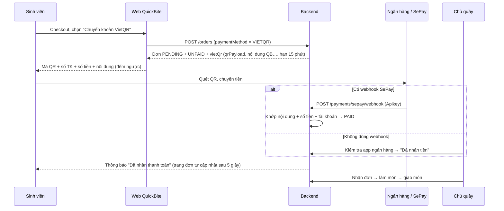

# Thanh toán chuyển khoản VietQR

Sinh viên có thể trả tiền bằng **mã VietQR**. Mã này quét được bằng mọi app ngân hàng Việt Nam và cả ví ZaloPay, MoMo. Tiền chuyển **thẳng vào tài khoản ngân hàng của quầy**. QuickBite không giữ tiền, không cần đăng ký cổng thanh toán và không mất phí giao dịch.

## 1. Luồng hoạt động



## 2. Quy tắc

| Quy tắc | Chi tiết |
|---|---|
| Quầy phải cài tài khoản | Chủ quầy vào **Thông tin quầy → Nhận chuyển khoản VietQR** và nhập ngân hàng, số tài khoản, tên chủ tài khoản. Nếu chưa cài, ô "Chuyển khoản VietQR" ở checkout bị khoá, và API trả `422` khi đặt đơn VIETQR. |
| Số tiền tính ở server | Số tiền trong QR bằng `total` của đơn trong database, không lấy từ client. |
| Nội dung chuyển khoản | Là mã đơn bỏ dấu gạch, ví dụ `QB-261020-4F7K` → **`QB2610204F7K`**. Server tìm mã này trong nội dung ngân hàng gửi về, kể cả khi app ngân hàng chèn thêm chữ hoặc bỏ dấu cách. |
| Chụp lại tài khoản lúc đặt | Bảng `payments` lưu ngân hàng và số tài khoản tại thời điểm đặt. Quầy đổi tài khoản sau đó thì đơn cũ vẫn dùng tài khoản cũ. |
| Chưa trả tiền thì chưa nhận đơn | Đơn VIETQR còn `UNPAID` thì quầy **không chuyển được sang ACCEPTED** (API trả `422`). Quầy vẫn từ chối được. |
| Hạn thanh toán | Mỗi quầy tự chọn **5–60 phút** (mặc định 15) ở **Thông tin quầy → Nhận chuyển khoản VietQR → Thời gian chờ chuyển khoản**. Hết giờ mà chưa có tiền thì **giao dịch bị huỷ**: đơn chuyển sang `CANCELLED` / `VOIDED`, mã QR biến mất và sinh viên lẫn quầy nhận thông báo. Đơn được huỷ ngay khi sinh viên hoặc quầy mở đơn, đồng hồ đếm ngược về 0 trên trang đơn, hoặc tác vụ nền chạy (15 giây một lần). |
| Đã trả thì sinh viên không tự huỷ | Đơn đã `PAID` phải liên hệ quầy để huỷ và được hoàn tiền. |
| Tiền về sau khi đơn đã huỷ | Server vẫn ghi nhận `PAID` và báo quầy **"Cần hoàn tiền"**. Quầy hoàn tiền thủ công cho sinh viên. |
| Quầy huỷ/từ chối đơn đã trả | Thông báo gửi sinh viên có ghi "sẽ được quầy hoàn lại". |
| Chống xử lý trùng | Webhook gửi lại cùng giao dịch trả `ALREADY_PAID`. `providerRef = SEPAY-<id>` là UNIQUE. Mọi cập nhật đều có điều kiện theo trạng thái (`UPDATE … WHERE status = …`), nên tiền về đúng lúc đơn hết hạn hay đúng lúc sinh viên bấm huỷ cũng không làm hỏng dữ liệu. |

## 3. Mã QR được tạo thế nào

`backend/src/modules/payments/vietqr.ts` tự tạo chuỗi theo **chuẩn EMVCo / NAPAS VietQR**, không gọi dịch vụ ngoài:

```
00 02 01                      phiên bản
01 02 12                      QR động (có số tiền)
38 .. 0010A000000727          GUID NAPAS
      01.. 00 06 970436       BIN ngân hàng (Vietcombank)
           01 10 1023456789   số tài khoản
      02 08 QRIBFTTA          chuyển tới tài khoản
53 03 704                     VND
54 05 70000                   số tiền
58 02 VN
62 16 08 12 QB2610204F7K      nội dung chuyển khoản
63 04 XXXX                    CRC16-CCITT
```

Frontend dùng thư viện `qrcode` để vẽ chuỗi này thành ảnh ngay trên trình duyệt. Danh sách ngân hàng và mã BIN nằm ở `vietqr-banks.ts`, đọc qua API `GET /api/v1/payments/banks`.

## 4. Tự xác nhận bằng SePay (tuỳ chọn)

[SePay](https://sepay.vn) đọc biến động số dư tài khoản ngân hàng và gửi webhook về server. Gói miễn phí đủ dùng cho một quầy nhỏ.

1. Đăng ký SePay và liên kết tài khoản ngân hàng của quầy.
2. Tạo API key ngẫu nhiên rồi đặt vào `backend/.env`:
   ```
   SEPAY_WEBHOOK_API_KEY=<chuỗi ngẫu nhiên ≥ 16 ký tự>
   ```
3. Trong SePay, vào **Webhooks → Thêm webhook**:
   - URL: `https://<tên-miền-của-bạn>/api/v1/payments/sepay/webhook`
   - Kiểu chứng thực: **API Key**, dán đúng key ở bước 2.
4. Khi chạy trên máy local, SePay không gọi được `localhost`. Có 2 cách:
   - Dùng đường hầm, ví dụ `cloudflared tunnel --url http://localhost:4000`, rồi dán URL tạm vào SePay.
   - Bỏ qua webhook: chủ quầy bấm **"Đã nhận tiền"** sau khi kiểm tra app ngân hàng.

### Giả lập webhook khi phát triển (PowerShell)

```powershell
$body = @{ id = 1001; accountNumber = "1023456789"; content = "QB2610204F7K chuyen tien"; transferType = "in"; transferAmount = 70000 } | ConvertTo-Json
Invoke-RestMethod -Method Post -Uri http://localhost:4000/api/v1/payments/sepay/webhook `
  -Headers @{ Authorization = "Apikey <SEPAY_WEBHOOK_API_KEY>" } -ContentType "application/json" -Body $body
```

Thay `QB2610204F7K` bằng nội dung chuyển khoản hiển thị trên trang đơn, và `70000` bằng tổng tiền của đơn.

Kết quả trả về luôn là `200`, kèm `matched` cho biết có khớp đơn không. Khi `matched: false`, trường `reason` ghi lý do:

| `reason` | Ý nghĩa |
|---|---|
| `NOT_INCOMING` | Giao dịch tiền ra, bỏ qua |
| `NO_ORDER_CODE` | Nội dung không có mã đơn `QB…` |
| `ORDER_NOT_FOUND` | Không có đơn chuyển khoản nào khớp mã |
| `AMOUNT_TOO_LOW` | Chuyển thiếu tiền (cần xử lý thủ công với sinh viên) |
| `ACCOUNT_MISMATCH` | Tiền vào tài khoản khác tài khoản của quầy |
| `ALREADY_PAID` / `DUPLICATE` | Đã xác nhận trước đó (`matched: true`) |

## 5. Bảo mật

- Webhook chỉ chấp nhận header `Authorization: Apikey <key>`. Key được so sánh hằng thời gian (timing-safe). Nếu không cấu hình key thì endpoint trả `404`.
- Số tài khoản **không** xuất hiện ở trang công khai, trang công khai chỉ có cờ `acceptsVietQr`. Số tài khoản chỉ hiện cho chủ đơn và nhân viên quầy.
- Chỉ **chủ quầy** (OWNER) hoặc admin được đổi tài khoản nhận tiền. Nhân viên (STAFF) chỉ xem.
- Xác nhận thủ công "Đã nhận tiền" ghi lại người xác nhận (`payments.confirmedById`) và nguồn xác nhận (`provider = MANUAL`).

## 6. API liên quan

| Method | Đường dẫn | Ai dùng |
|---|---|---|
| GET | `/payments/banks` | Công khai |
| POST | `/payments/sepay/webhook` | SePay (Apikey) |
| POST | `/orders` với `paymentMethod: "VIETQR"` | Sinh viên |
| GET | `/orders/:id`, trả thêm `vietQr` và `awaitingPayment` | Sinh viên |
| PATCH | `/vendor/stalls/:stallId` với `bankAccount: { bankBin, accountNo, accountName }` hoặc `null` | Chủ quầy |
| POST | `/vendor/stalls/:stallId/orders/:orderId/confirm-payment` | Chủ quầy / nhân viên / admin |
